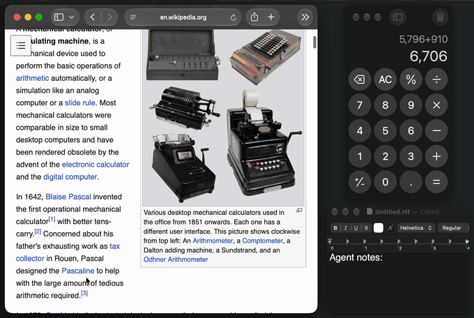

# glovebox

[](https://github.com/vpatel9202/glovebox/actions/workflows/test.yml)
[](https://www.npmjs.com/package/@vashp2029/glovebox)
[](LICENSE)
[](#status)

[](https://mcprush.com/to/vpatel9202-glovebox-mcp?ref=badge)

**Computer use for coding agents on macOS: one JavaScript call per step,
accessibility diffs instead of screenshots, and your screen stays yours.**



```js
const calc = await gb.getApp("Calculator");
await calc.pressKey("Escape");
await calc.typeText("6*7=");
await calc.getAXState();
```

```
Calculator — window 0 "Calculator" — image 460x816 — changes since last read (~ changed, + added):
~					8 scroll area id=StandardInputView;value:42
~						9 text "Edit field" value="42"
```

On the next call, `calc` is still bound. An agent writes a few lines per step
instead of making one tool call per click, and reads what changed instead of a
fresh picture of the window.

- **A script per step, not a tool call per click.** Bindings and helper
  functions persist across calls, so one call can click, type, loop, and read.
- **Diffs, not screenshots.** The default read is the accessibility tree as
  text, and later reads show only changes. Screenshots and pixel clicks are
  there when the tree is empty (Citrix, canvases).
- **Background by default.** Keys, clicks, drags, and scrolls reach the app
  while you keep working in another one. Your cursor stays put, and a drawn
  cursor shows what the agent is doing.

In an [author-run test](#benchmark) of six setups on 12 tasks (2 runs each),
glovebox had the lowest total cost, $0.57 against $1.41 to $5.67, and the
fewest round trips and the most passes.

**What to know first:** macOS only, tested on macOS 27 on Apple silicon. You
need the Xcode command line tools to build a small helper app, and you grant it
Accessibility and Screen Recording. Background input uses two private macOS
calls, with a foreground fallback. Only Claude Code has been tested end to end.
Despite the name, this is not a sandbox, and it is unrelated to
[glovebox-mcp](https://github.com/segentic-lab/glovebox-mcp).

## Quickstart

Requires Node 20.10+ and the Xcode command line tools (`xcode-select --install`).

```bash
npm install -g @vashp2029/glovebox
glovebox signing --create   # optional: macOS keeps the grants across helper rebuilds
glovebox setup              # builds the helper, walks through permissions
glovebox doctor             # every line should say ok
glovebox smoke              # a real end-to-end test on Calculator
claude mcp add --scope user glovebox -- glovebox mcp
```

`setup` builds **Glovebox Helper.app** into `~/.glovebox/` and asks you to turn
it on under System Settings > Privacy & Security > **Accessibility** and
**Screen & System Audio Recording**. **Input Monitoring** is optional and only
enables Escape-to-stop. The helper is its own app, so one grant covers every
agent and terminal. `signing --create` makes a self-signed certificate in your
login keychain that signs only the helper. Without it, macOS treats each
rebuild as a new app; see the [upgrade note](CHANGELOG.md#upgrading).

**Works with:** Claude Code (tested end to end). Codex, Grok CLI, OpenCode,
Gemini CLI, and Cursor have documented configs that have not been exercised.
Any agent that can run shell commands can use `glovebox run`.
See [docs/agents.md](docs/agents.md).

## Why not Claude Code's built-in computer use?

If it fits your setup, it is the easier choice: nothing to install, supported
by Anthropic, and it keeps your terminal out of screenshots. glovebox is for
the cases where it does not fit. From [Anthropic's docs](https://code.claude.com/docs/en/computer-use),
checked 2026-11-03:

| | Claude Code built-in | glovebox |
|---|---|---|
| Your other apps | Hidden while Claude works | Stay visible; input goes to the target app in the background |
| Default read | Downscaled screenshot | Accessibility text diff |
| Who can use it | Pro, Max, or Ultra through claude.ai; not Team, Enterprise, Bedrock, Google Cloud, or Foundry | Anyone; it never talks to a model or an account |
| Scripted runs | Not in `-p` mode | The benchmark drives it unattended from a script; `claude -p` itself not yet tested |
| Sessions | One at a time, enforced by a lock file | No global lock; named sessions run side by side |
| Remembering approvals | This session only | Allow for This Session or Always Allow |
| Browsers | View-only | Full control once you approve the browser, which is more power and more risk |

**Claude Code's built-in tool was not in the benchmark below**, so this table
compares documented behavior, not measured results.

## Benchmark

Twelve macOS tasks, six setups, two runs each, 2026-11-03. Same model (Claude
Sonnet 5.5, medium effort), prompt, and agent loop for every setup; only the
tool changes. Task prompts name no tool, and a separate check that doesn't use
the tool under test decides each result.

| Setup | Passed | Round trips | Images returned | Cost at list price |
|---|---|---|---|---|
| glovebox | 24/24 | 128 | 21 | $0.57 |
| Codex `cua_repl`, driven by Claude | 20/24 | 166 | 30 | $1.41 |
| Anthropic toolset, run by glovebox | 22/24 | 187 | 179 | $1.65 |
| agent-desktop | 22/24 | 204 | 22 | $2.32 |
| open-computer-use | 21/24 | 244 | 385 | $2.76 |
| Peekaboo | 20/24 | 359 | 183 | $5.67 |


**Where glovebox did not win.** It was not cheapest on `finder-rename`
($0.061 against $0.041 for Codex `cua_repl`). It did not have the fewest round
trips on 3 of the 12 tasks, or the fastest time on 3 of the 12. On
`remote-desktop` it took 36 seconds against 22 and 23 for two others.

**How much to trust this:**

- I wrote the tasks and ran the test, on one Mac, in one sitting. Several tasks
  (`bulk-entry`, `remote-desktop`, `coexistence`) were designed around things
  glovebox set out to do.
- With two runs per task, pass counts mean little: 24/24 against 20/24 is not
  statistically significant. The cost gap is the sturdier result, because it
  holds task by task: glovebox cost less than each other setup on at least 11
  of 12 tasks.
- The glovebox tested is the code released as 0.3.0. Result files say 0.2.0,
  because the version had not been bumped yet.
- "Anthropic toolset" is Anthropic's API computer-use toolset, executed through
  glovebox's foreground route. It failed `coexistence` because of that route,
  so that result doesn't describe a shipping product. "Codex `cua_repl`" measures
  the tool shape under Claude, not Codex with its own model.
- Peekaboo's first pass was rerun with foreground input allowed, which helped
  it. Its two `bulk-entry` failures were my $0.75 per-run budget cap stopping
  the run. agent-desktop ran through its CLI, not its MCP mode.

Method, per-task numbers, and raw results: [bench/](bench/README.md) and
[bench/results/v2/summary.md](bench/results/v2/summary.md).

## How it compares

Checked against each project's README and docs on 2026-11-03. "—" means I could
not confirm it from those.

| | Platforms | Actions per call | State between calls | Default read | Diffed reads | Background input | Needs |
|---|---|---|---|---|---|---|---|
| **glovebox** | macOS | many (one script) | persistent JS session | accessibility text | yes | yes | Xcode CLT to build the helper |
| Claude Code built-in | macOS (CLI) | — | — | screenshot | — | no, hides other apps | Pro, Max, or Ultra |
| Codex computer use | macOS, Windows | many (one script) | persistent JS session | accessibility text | yes | yes on macOS | ChatGPT app and plugin |
| [lcu](https://github.com/amontlabs/lcu) | macOS (Apple silicon), Linux | as Codex; it runs Codex's runtime | as Codex | as Codex | as Codex | — | ChatGPT app installed |
| [agent-desktop](https://github.com/vercel-labs/agent-desktop) | macOS, Windows, Linux | one per command, plus `batch` | refs tied to a snapshot | accessibility tree JSON | — | yes | Homebrew or npm |
| [Peekaboo](https://github.com/openclaw/Peekaboo) | macOS 15+ | one per command | element IDs from a snapshot | screenshot or JSON UI map | — | yes | Homebrew or npm |
| [open-computer-use](https://github.com/iFurySt/open-computer-use) | macOS, Linux, Windows | one per MCP call; CLI has sequences | — | app state | — | — | npm |
| [computer-use-mcp](https://github.com/minghinmatthewlam/computer-use-mcp) | macOS 14+ | one per call | element IDs | screenshot and tree per action | — | yes | notarized binary |
| [cua-driver](https://github.com/trycua/cua) | macOS, Windows, Linux | — | — | — | — | yes | see its docs |

**Pick something else if** you need Windows or Linux (agent-desktop, cua-driver,
lcu), a notarized binary with no build step (computer-use-mcp), or want
OpenAI's actual runtime and already have the ChatGPT app (lcu).

## Safety

The first time a session touches an app, you get a dialog: Allow for This
Session, Always Allow, or Deny. Terminals, password managers, System Settings,
and a few others are blocked unless you run `glovebox allow <bundle id>`; the
list is in [SECURITY.md](SECURITY.md#blocked-apps). A script that had to bring
an app forward stops if you switch away. Scripts running in the background keep
going while you use other apps, and Escape stops any script if you grant Input
Monitoring. Every action is
logged to `~/.glovebox/actions.log`.

An approved app is approved for everything in it: allowing a browser lets the
agent use every site you are signed in to. glovebox does not screen page
content for prompt injection. Treat it like giving someone remote control of
that app. Details: [SECURITY.md](SECURITY.md).

**Known issue:** while a background app's pop-up menu is open, macOS sends your
keystrokes to that app, so a word you type can land in it
([details](docs/api.md#known-limits)).

## How it works

```
agent ──MCP stdio──▶ glovebox mcp ──▶ kernel (persistent JS session)
agent ──shell──▶ glovebox run ──▶ daemon ──▶ kernel        │
                                                            ▼ Unix socket
                                        Glovebox Helper.app (Swift: AX, CGEvent,
                                        ScreenCaptureKit, approval dialogs)
```

Background input uses two private macOS (SkyLight) functions, looked up at
runtime with a foreground fallback; `glovebox doctor` reports which route you
have. Everything else is public API. No OpenAI, Anthropic, or other vendor
binaries.

## Status

| Platform | Status |
|---|---|
| macOS | Works. Built for macOS 14+; tested only on macOS 27 (Apple silicon). |
| Windows | Planned (UI Automation). See [roadmap](docs/roadmap.md). |
| Linux | Planned (AT-SPI; Wayland limited). See [roadmap](docs/roadmap.md). |

Run for real, not mocked: `glovebox smoke` and `smoke --full` over MCP (batched
steps, persistent bindings, diffs, pixel clicks, and background click, drag, and
scroll with another app frontmost), and Claude Code attached through
`glovebox mcp`. Full list: [docs/testing.md](docs/testing.md).

## The API in one screen

- `gb.getApp(name)` launches or finds an app without stealing focus. `gb.listApps()`.
- `app.getAXState()` returns the accessibility tree as text; later reads are
  diffs. `{frames: true}` adds element boxes, `{disableDiffing: true}` the full tree.
- `app.getScreenshot()` is the only way to get an image.
- `app.click(target)`, `doubleClick`, `rightClick`, `scroll`, `drag`,
  `setValue`, `focus`, `selectText`, `performSecondaryAction`.
- `app.pressKey("ctrl+a")` uses xdotool names (`super` is Cmd). `app.typeText("text\n")`.
- `app.waitForChange()` and `app.settle()` wait for a late update.
- A target is an element index from the tree or `[x, y]` pixels in the
  window image, which is the screenshot's pixel space.

Full reference: [docs/api.md](docs/api.md), or `help()` inside a session.

## Docs

- [docs/api.md](docs/api.md): the scripting API, for agents and script authors.
- [docs/agents.md](docs/agents.md): attaching each MCP client or a shell-only agent.
- [docs/cli.md](docs/cli.md): every subcommand, flag, config key, and environment variable.
- [docs/recipes.md](docs/recipes.md): short scripts to paste into one `js` call.
- [docs/design.md](docs/design.md): decisions and their reasons, for contributors and evaluators.
- [docs/backend-protocol.md](docs/backend-protocol.md): the helper protocol, for porting to a new platform.
- [docs/testing.md](docs/testing.md): unit and smoke tests, and what has been run on real hardware.
- [docs/roadmap.md](docs/roadmap.md): planned work; nothing there is shipped.
- [SECURITY.md](SECURITY.md): what protects you, what does not, and how to report a vulnerability.
- [CONTRIBUTING.md](CONTRIBUTING.md): setup from a clone, tests, and pull request rules.
- [CHANGELOG.md](CHANGELOG.md): changes per release and upgrade notes.

## License

MIT
