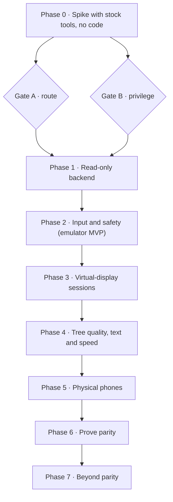

# Android plan

A plan to bring nostrings to feature parity on Android. Nothing here is built
or tested; it is a plan, written 2026-11-15.

## Summary

nostrings reaches Android parity as a second backend behind the existing
[backend protocol](backend-protocol.md), with a new on-device server in place
of Nostrings Helper.app. The diffs, the MCP server and the CLI keep their
shape, but the kernel, the App layer and the protocol need the changes listed
in [Kernel and protocol changes](#kernel-and-protocol-changes): today they
assume one macOS backend per kernel. Nothing in this plan has been run on a
device, so the first phase is a throwaway spike, and every later phase
depends on it.

**Who it is for.** One user and their agent, on the user's own devices,
personal phone included: the agent should be able to do anything on the phone
that the user could. A human stays in the loop. nostrings asks the user before
sensitive steps, but it does not forbid any action the user approves at the
time. Decided 2026-11-18.

**Target architecture.** The host (Mac or Linux) runs the kernel and daemon
as today. Over ADB it starts a server on the phone with shell privileges
(`app_process`, the pattern scrcpy uses), pushed as a dex file, so there is
no APK to install. That server reads the accessibility tree through
`UiAutomation`, injects input, captures the screen, and runs each session on
its own virtual display so the user's real screen is never touched. The
default display is the fallback, the same role the foreground route plays on
macOS. The first targets are the emulators and the user's own phone (a
Galaxy S24 Ultra) together: emulators carry CI and risky tests, the phone is
where the work is.

**What parity means.** Three things, all measured:

1. Every call in [api.md](api.md) works with the same names and semantics, or
   has a documented Android equivalent.
2. The seven properties in [design.md](design.md) "The bar" hold: one call
   per step, persistent session, diffed text reads, screenshots only on
   request, clicks in image-pixel space, cheap pixel and element actions, no
   doc dumps.
3. The safety model (approval, blocked apps, stop, action log) and the
   lifecycle commands (`setup`, `doctor`, `smoke`) exist, and an Android
   version of `bench/` runs.

**Two gates.** After a no-code spike: (A) the virtual display becomes the
default route, or v1 ships on the default display with virtual displays
opt-in; (B) the server builds its accessibility connection from shell, or
that half moves into a small instrumentation APK. Because the virtual display
is a route behind the existing `background_unavailable` fallback, not the
architecture, both answers leave the rest of the plan intact.

## Parity map

Of 33 macOS features, 11 port directly, 16 need a redesign, 4 are better on
Android, and 2 have no equivalent (the menu bar and code signing). Rows follow
the order of `api.md`, then `design.md` and `SECURITY.md`.

| macOS feature | Android approach | Parity |
| --- | --- | --- |
| Persistent JS session, `js` / `js_reset`, CLI daemon | Same tools and daemon, but the kernel holds one backend per device instead of one per process, and scripts see the target's platform, not only the host's `process.platform` (see Kernel and protocol changes) | Redesign |
| `ui.getApp(query)` launches without focus | Resolve label or package name; `am start --display <session display>` | Port |
| `ui.listApps({installed})` | PackageManager plus running tasks per display | Port |
| `ui.permissions()` | Reports ADB link, server alive, accessibility connection, virtual display allowed, competing automation | Redesign |
| `getAXState` text tree and diffs | Accessibility node tree; Android, Compose and Flutter roles mapped onto the AX role names | Port |
| Stable element indices (`CFEqual` table) | Table keyed by window id plus node id, with a generation counter: lists reuse nodes and WebView ids reset on reload, so a reused index must raise `stale_index` | Redesign |
| `menus: true` (menu bar) | No menu bar; overflow menus are ordinary popup windows. Drop it | No equivalent |
| `frames: true`, image-pixel coordinates | One display is one image; the scale formula is unchanged | Port |
| `getScreenshot` | Read the virtual display's surface; `screencap` on the default display. Secure windows come back black | Port |
| `waitForChange`, `settle` | Polling first, as today; later driven by the accessibility event stream | Better on Android |
| `windows()` | The nostrings window becomes the display or task, its windows merged in z-order. Dialogs, sheets and the keyboard must take over reads, the opposite of the macOS rule | Redesign |
| `click` (accessibility press, else pointer) | Click action on clickable nodes, else an injected tap | Port |
| `doubleClick`, `rightClick`, modifiers | Double tap; right click becomes long press; most modifiers mean nothing | Redesign |
| `pressKey` (xdotool names) | Android key codes; add Back, Home, Recents as global actions | Redesign |
| `typeText` | Ladder: set the field's text, then key events, then paste, reading back after each | Redesign |
| `scroll` | Scroll actions on the node, else an injected swipe; "lines" needs a new unit | Port |
| `drag` | Injected touch path; add `swipe`, `longPress`, `pinch` | Port |
| `setValue`, `focus`, `selectText`, secondary actions | Matching node actions (set text, focus, set selection, custom actions) | Port |
| `activate()` | Move the task to the default display, or bring it to the front there | Redesign |
| Background input (SkyLight private calls) | One virtual display per session, as a route behind `background_unavailable`; Android 14 (API 34) floor if per-display focus needs it | Better on Android |
| Foreground fallback; switching away stops the script | Default display; stop when the top task changes without the agent causing it | Redesign |
| Focus guard | Becomes "did the task or focus leave my display", checked before each action | Redesign |
| Drawn agent cursor | Nobody sees a virtual display; draw it in a host live view, and use the pointer-location overlay on the default display | Redesign |
| Menu-bar status item (sessions, stop, revoke) | Host tray item; on-phone indicator through a notification if shell can post one, else an optional companion app | Redesign |
| Escape to stop | Host Escape as today; on the phone, a hardware key pattern, or unplugging (server death stops everything) | Redesign |
| Approval dialog in the helper | Prompt on the host; the phone server enforces the decision | Redesign |
| Blocked apps | New Android ask-first list (approval, not a block), checked against the package of the window being acted on, not only the app launched | Redesign |
| Action log | Host log as today, plus device serial and display id | Port |
| `setup`, `doctor`, `smoke` | ADB discovery and server push; capability probes that name the vendor toggle; smoke against an owned fixture app | Redesign |
| `signing` (keep grants across rebuilds) | Not needed: no grant is tied to the server's signature | No equivalent |
| Named sessions side by side | One virtual display per session: real isolation, not just separate bindings | Better on Android |
| Semantic shortcuts | New: intents and deep links by allowlist, later AppFunctions | Better on Android |
| Pixel fallback for one-node trees | Screenshots and taps; OCR on the host | Port |

## Kernel and protocol changes

The host side assumes one macOS backend today. These are the places that
change, read from the source on 2026-11-18. Phase 1 makes them before any
Android method works end to end, and edits
[backend-protocol.md](backend-protocol.md) in the same change rather than
keeping a second contract here.

| Where | Today | Change |
| --- | --- | --- |
| [`src/backends/index.mjs`](../src/backends/index.mjs) | `createBackend` switches on `process.platform` and returns the macOS backend or an "unsupported" stub | A registry: the macOS backend for the host, plus one Android backend per ADB serial, created on first use |
| [`src/kernel.mjs`](../src/kernel.mjs) | Builds a single `backend` when the module loads and hands it to every script and session; the Escape listener hangs off it | Keeps the registry instead; `ui.device(serial)` returns an object with the same `getApp` / `listApps` surface bound to that device's backend; stop events come from every backend |
| `src/kernel.mjs`, script sandbox | Scripts see `process.platform` of the host | Unchanged for the host; device objects report their own platform, so recipes branch on the target, not the host |
| [`src/api.mjs`](../src/api.mjs), App objects | Every request sends `{pid}`; the session's app map is keyed by `pid` | Keyed by device plus handle, so a Mac pid and a phone pid cannot collide; the handle the backend returns stays opaque to the App layer |
| `src/api.mjs`, activate fallback | Runs `open -b <bundleId>` when activation fails, guarded by `process.platform === "darwin"` | Moves behind the backend (`activate` reports its own failure), so the App layer has no OS-specific commands |
| [`src/smoke.mjs`](../src/smoke.mjs) | Proves input stayed in the background by asking `osascript` for the frontmost app | A per-backend check: on Android, the focused display and top task from `dumpsys` |
| [`backend-protocol.md`](backend-protocol.md) | Coordinates are "global screen points"; `pid` is a number; roles are macOS AX names | The contract becomes per backend. macOS keeps global screen points and numeric pids, unchanged. An Android backend's coordinates are relative to its target display, and its app handle is an opaque string (package, task and display packed in). The App layer treats the handle as opaque either way. The role mapping rule stays, with Android's map documented next to it |

The diff engine, MCP server, CLI daemon and config format do not change
shape. Config gains an Android blocked-app list and per-device settings.

## Phases

Eight phases, 0 to 7: a no-code spike, then an emulator MVP on the default
display, then virtual displays, then real phones, then proof of parity.
Phase 7 is beyond parity. Nothing is sized in days, because the spike decides
how hard Phases 3 and 5 are.

Phases 1 to 4 run on emulators in CI. The Phase 0 spike also uses one
physical phone, because the two riskiest questions (focus and the shell
accessibility connection) may get a vendor-specific answer. Phase 5 is where
phones become a supported target. Gate A decides whether Phase 3 makes
virtual displays the default or an option.

### Phase 0: spike with stock tools, no code

Run on emulators for Android 14 through 17 (API 34–37) and on one physical
phone, a Samsung Galaxy S24 Ultra. Read on 2026-11-18 with `adb shell
getprop`: model SM-S928U1, Android 17, API 37
(`ro.build.version.sdk`), One UI 9 (`ro.build.version.oneui` 90000), build
S928U1UEU6EZIF. Re-read these before each spike run, since an OTA changes
them. Use only `scrcpy --new-display`, `am start --display`,
`input -d`, `uiautomator dump` and `dumpsys`. `uiautomator dump` already
builds an accessibility connection from shell, so it tests the riskiest
assumption for free.

The S24 is a personal phone, so the spike drives only stock apps that hold no
accounts or codes (Clock, Calculator, Calendar with no account, a browser on
a blank profile), never Messages, Settings or anything on the blocked list in
Security model.

**Setup, done 2026-11-18.** On this Mac (Apple Silicon, 16 GB RAM):

| Device | Image | Serial | Result |
| --- | --- | --- | --- |
| `gb_api34` (Pixel 8 profile) | API 34 `google_apis` arm64-v8a | `emulator-5554` | Boots in about 45 s; injected swipe changes the screen; scrcpy sees display 0 |
| `gb_api35` (Pixel 8 profile) | API 35 `google_apis` arm64-v8a | `emulator-5556` | Boots in about 30 s; the first swipe after boot was ignored, and the same swipe 15 s later worked (launcher still starting) |
| `gb_api36` (Pixel 8 profile) | API 36 `google_apis` arm64-v8a | `emulator-5558` | Boots in about 50 s; swipe works; scrcpy sees display 0 |
| `Medium_Phone_API_37.0` (made by Android Studio) | API 37.0 `google_apis_playstore` arm64-v8a | `emulator-5560` | Boots in about 70 s; swipe works; scrcpy sees display 0. Play Store images cannot `adb root` |
| Galaxy S24 Ultra | Android 17, API 37 | USB serial | An injected wake key moved it from Dozing to Awake, so Samsung Auto Blocker does not block `adb` input in its current setting |

The emulators run one at a time: four at 2 GB of guest RAM each is too much
for 16 GB. The spike waits about 15 s after `sys.boot_completed` before the
first input. scrcpy is 5.0.1. `avdmanager` must be the SDK's own
(`cmdline-tools;latest`); the Homebrew `android-commandlinetools` copy looks
for images under its own SDK root and rejects these paths.

**Results (2026-11-18): [android-spike.md](android-spike.md).** In short:
- Stock scrcpy loses Q1. A probe display with the hidden
  `STEAL_TOP_FOCUS_DISABLED` flag passes it on emulators.
- Q2 works only while the virtual display has focus.
- Q3 passes 56–83% of apps.
- Gate B is met. Gate A is not met as written; the decision is bead
  `gb-7my.3`.

Questions it must answer:

1. Does the default display keep focus while the agent taps on a virtual
   display?
2. Does the accessibility tree include windows on the virtual display?
3. Out of a list of about 20 apps, how many launch on the virtual display,
   respond, and stay there?
4. What happens when the user opens the same app on the phone screen?
5. Can text be entered on the virtual display without a keyboard showing up on
   the phone screen?
6. What happens to the virtual display's apps when the server is killed?
7. Does any of this survive the screen being locked or off?

**Gate A (route).** The virtual display becomes the default route only if
questions 1 and 2 pass on every emulator API level and at least 80% of the
app list passes question 3. Otherwise the default display is the default
route and virtual displays are opt-in. The S24 does not count toward the
threshold, since one vendor build is not a sample, but a failure there that
the emulators do not show is recorded as a vendor risk for Phase 5.

**Gate B (privilege).** If an accessibility connection cannot be built from
shell on two or more emulator API levels, or on the S24, the accessibility
half moves into a small instrumentation APK (see Alternatives). The S24 counts
here because a shell route that fails on the most common vendor build is not
a route. Input, capture and displays stay in the shell server either way.

### Phase 1: read-only backend on the emulator

- On-device server, pushed and started by the host, speaking the existing
  JSON-lines protocol over an ADB-forwarded socket. It answers `hello`,
  `ping`, `listApps`, `resolveApp`, `windows`, `axTree` and `screenshot`.
- The host changes in [Kernel and protocol changes](#kernel-and-protocol-changes),
  then `src/backends/android.mjs`, chosen per device through `ui.device()`
  rather than by `process.platform`, because the host is still a Mac.
- Role map (Views, Compose, Flutter, WebView) onto the AX role names.
- Element index table with a generation counter.
- Window model: the display or task is the nostrings window, with its windows
  merged in z-order.
- Display id kept inside the opaque window and app handles, not added to
  every method.
- A fixture APK nostrings owns (see Test strategy) and a backend conformance
  suite that runs the same protocol scripts against either backend.

**Exit:** conformance read tests pass on the emulator matrix, and tree read
time on the fixture is measured and recorded.

### Phase 2: input and safety, emulator MVP

- `keys`, `type` (the set-text, key events, paste ladder with read-back),
  `click`, `scroll`, `drag`, plus `swipe`, `longPress` and global actions.
- Approval on the host, enforced in the server; ask-first apps checked against
  the acted-on window's package; action log with device serial.
- Server death stops everything (no `nohup` in v1); detection of a competing
  automation tool holding the accessibility slot.
- `doctor` and `smoke` for Android, the smoke test against the fixture app.
- A first cut of the Android bench, so later phases are measured.

**Exit:** smoke passes on the emulator matrix, and Claude Code drives an
emulator end to end over MCP.

### Phase 3: virtual-display sessions

Default or opt-in, depending on Gate A.

**Status (2026-11-18): single-session hidden screen done, and the default on
API 34+.** Each app handle gets its own display (flags `0x1fdcb`, keyboard
policy `hide`), launched as its own task (NEW_TASK | MULTIPLE_TASK). Input,
focus lookup, `Back` and screenshots target that display, with no fallback
to display 0. A move to display 0 stops with `moved_to_phone_screen`.
Teardown removes the display's tasks, then the display. Apps the user is
running are refused (`open_on_phone`), since a second copy can move or
close the user's. A dim-screen wake
lock covers hidden work, because nothing on a hidden screen runs while the
phone sleeps. Two findings changed the plan: `am start -W` never returns
while the phone sleeps, and parallel sessions need a shared server, since a
phone allows one shell automation connection. That server is shared through
a per-phone broker on the host (`src/backends/android-broker.mjs`), and the
server runs each session on its own thread.

- One display per session, created with scrcpy's per-API flag choices and
  destroyed with its content on teardown, so agent apps never land on the
  user's screen.
- Check before each action that the task is still on the session's display;
  stop with a coded error if it moved.
- Keyboard policy for the display; parallel named sessions.

**Exit:** the "default display untouched" checks (focus, a screenshot hash
before and after, emulator capture as an independent check) pass across the
matrix with two sessions running.

### Phase 4: tree quality, text and speed

- Hardening against fixture screens: list item reuse, WebView, Compose, a
  split one-time-code field.
- Event-driven `waitForChange`.
- The large-tree outline and the silent lookups from the macOS
  [roadmap](roadmap.md), plus OCR on the host for one-node trees.

**Exit:** the fixture suite passes, and the bench shows round trips and cost
per task.

### Phase 5: physical phones

- USB first, then wireless ADB, with reconnect and re-pair handling.
- `doctor` probes each capability and names the vendor toggle when one blocks
  it.
- Device matrix and the physical-only checks in Test strategy.

**Exit:** a published support matrix per device and Android version.

### Phase 6: prove parity

- Full Android bench, including a comparison on AndroidWorld.
- Android sections in `api.md`, `agents.md` and `SECURITY.md`; the emulator
  matrix in CI.

**Exit:** every row of the parity map is done or documented as a limit, and
the README Status table lists Android as working, with tested versions.

### Phase 7: beyond parity

Allowlisted intents and deep links, AppFunctions if shell can call them, the
on-phone setup through Shizuku, and a separate work profile or a dedicated
phone for agent apps (see Alternatives).

## Risk register

The two assumptions most likely to break are that the phone screen keeps
focus while the agent works on another display, and that an accessibility
connection can be built from shell and share the device with other tools.
Rows run from most to least likely to fail. "Unconfirmed" marks claims from
memory, not from a source.

| Assumption | Why it may fail | Early signal | Mitigation | Fallback |
| --- | --- | --- | --- | --- |
| The phone screen keeps focus while the agent taps elsewhere | Input on another display can move system focus: the user's video pauses, keyboard closes. Per-display focus may need Android 14 and a trusted display (unconfirmed) | Focused display in `dumpsys` before and after a tap; fixture logs focus changes | Android 14 floor for the background route | Answer `background_unavailable`, use the default display |
| Shell can open an accessibility connection that coexists | Only one automation connection system-wide, so Appium, Maestro and `uiautomator dump` conflict. Connecting suspends TalkBack unless a flag is set. The hidden constructor changes between releases. Less prior art than first assumed: uiautomator2 and Maestro use instrumentation APKs, not shell servers | "Already registered" error; `dumpsys accessibility` | Always set the don't-suppress flag; `doctor` names a competing tool | Instrumentation APK using the public API with shell permissions |
| Text can be entered reliably | Setting text skips validation listeners and fails in WebView, Flutter and games; key injection has no emoji or CJK; paste overwrites the user's clipboard; the keyboard may appear on the phone screen | Fixture text screens, including a split one-time-code field | Ladder with read-back after each step; paste off by default | A minimal input method nostrings ships (APK) |
| Apps behave on a virtual display | One task per app; launcher trampolines relaunch on the phone screen; billing, permission and biometric sheets may land there (unconfirmed which); integrity checks | Spike pass rate over about 20 apps | Check the task's display before each action; stop with a coded error | Per-app `foregroundApps`, which the config already has |
| Shell can set the display flags it needs | Trusted, own-group and always-unlocked flags vary by API level (unconfirmed); the secure flag is out of shell's reach, so secure windows capture black | Flags in `dumpsys display` after creation | Copy scrcpy's per-API flag choices | Default display |
| Work continues while locked or screen-off | Doze, app standby and vendor battery killers; keyguard behaviour on a virtual display unknown | The same script locked and unlocked, with frame timestamps | Keep-active; ask before acting while locked | Unattended work on the emulator |
| Clean teardown | An ADB drop kills the server; a display removed without destroying its content moves agent apps onto the user's screen | Kill test in the spike | Always destroy content on removal | Server death is the kill switch, by design |
| Hidden APIs and vendor gates hold | scrcpy needs fixes for most releases; Xiaomi needs "USB debugging (Security settings)" for injection; Samsung Auto Blocker may block USB commands (unconfirmed) | `SecurityException` on the first injection | Reuse scrcpy's wrapper classes (Apache-2.0); `doctor` probes each capability | Per-vendor setup notes |
| Element indices stay stable | Lists reuse nodes for new rows; window ids change when an activity is recreated; WebView ids reset on reload | Fixture list and WebView screens | Generation counter so a reused index raises `stale_index` | Read again |
| Sensitive views are visible | Android 16 lets apps hide views from accessibility services that are not accessibility tools; unknown whether a shell connection counts as one | Fixture screen with a flagged view | Treat hidden views as blocked, which is the safe outcome | Screenshot, black if the window is also secure |
| Advanced Protection leaves shell alone | Android 17 revokes accessibility from non-tool apps when it is on; effect on a shell connection unknown | Physical test with Advanced Protection on | Detect it in `doctor` | Document as unsupported |
| Apps run with developer options on | Banking apps and some games refuse | Launch error or app message | Tell the user; nothing nostrings can fix | None: by design |

Tree read speed is a smaller risk than it looks: expect roughly 100 to 500 ms
for an 800-node tree, slower in WebView (unconfirmed). Polling is acceptable
until Phase 4.

## Alternatives considered

The pick is a shell server for displays, input and capture, reusing scrcpy's
wrapper classes rather than rewriting them, with an instrumentation APK
designed in as the fallback for the accessibility half.

| Option | What it gives | Cost or catch | Verdict |
| --- | --- | --- | --- |
| Shell server via `app_process` | Displays, input, capture and accessibility with nothing installed | Hidden APIs; lives only as long as ADB | Chosen |
| Instrumentation APK (`am instrument`, shell permissions adopted) | The public accessibility API with shell's permissions; ADB installs skip developer verification | An install; possible Play Protect warning | Fallback at Gate B |
| Accessibility-service APK (the droidrun approach) | Runs with no computer attached; fast actions | User enables it in Settings; Advanced Protection revokes it; sensitive views hidden | Rejected for v1 |
| uiautomator2 or Maestro as the backend | Off the shelf | Holds the single automation slot; no virtual-display control | Throwaway demo only |
| Shizuku | A shell server started on the phone itself | Restart after every reboot | Phase 7, same server code |
| Root | Adds capture of secure windows | Few users; voids the security story | Skip |
| Work profile for agent apps (unconfirmed) | A second copy of each app with its own accounts, so the user and agent never fight over one task | Setup per device; behaviour on a virtual display unknown | Spike item, Phase 7 |
| Device owner on a dedicated agent phone | The OS enforces the blocklist (package suspension) and controls the lock screen | A reset phone with no personal accounts | Phase 7, for unattended phones |
| VirtualDeviceManager | Per-device rules for apps, clipboard and keyboard; virtual input that looks like hardware | Permission likely out of shell's reach (unconfirmed) | Research only |
| Emulator console and gRPC | Input and capture outside the device | Emulator only | Test oracle, not a backend |

## Security model

On Android the ADB key is the grant, so the approval gate means nothing
against an agent that has a shell: it can run `adb shell input` directly and
skip nostrings entirely. On macOS the helper holds the grants, so an agent's
terminal cannot do that. These go into an Android section of
[SECURITY.md](../SECURITY.md).

1. **Key custody.** The ADB key stays on the Mac (open decision 3). An agent
   with a shell there can bypass nostrings through `adb`, so the user's
   approval of that shell is the control, as on macOS today.
2. **No raw shell over the wire.** The server exposes named methods only;
   nothing the kernel can call runs arbitrary commands.
3. **Gate each window, not each app.** Payment sheets, permission dialogs,
   passkey and password sheets, autofill, share choosers and the package
   installer appear inside an approved app's task under other packages. Check
   the package of the window being acted on, every action, and ask the user
   first for: Play purchase screens, the permission controller, the credential manager,
   the package installer and system UI.
4. **Ask first, never forbid.** Settings, Play Store, Shizuku, banking and
   wallet apps, password managers, authenticator apps, Messages, the phone
   dialer, launchers and the notification shade need the user's approval at
   the time, not a standing block. Messages and notifications matter most,
   because one-time codes land there. (Decided 2026-11-18: the tooling must
   not prevent an action the user approves.)
5. **Locked phone.** Ask before acting while the phone is locked. The spike
   showed a virtual display keeps working behind a PIN lock screen, so this
   is a lock-screen bypass for whoever holds the host; the prompt is the
   control.
6. **Make it visible.** A virtual display shows the user nothing, so an
   on-phone indicator and a physical stop are required, not optional.
7. **Shared state.** Clipboard, notifications and signed-in accounts are
   shared across displays. Clipboard paste stays off by default.
8. **Device socket.** A random socket name plus a token, and a peer uid check.
9. **Intents skip the UI and the gate.** `tel:`, `sms:` and payment links act
   without a screen to approve. Allowlist by action and package, no raw URIs,
   no content-provider queries in v1.
10. **Host files.** Screenshots and logs on the host now hold messages and
    codes; set a retention limit.
11. **Developer options are themselves a downgrade** on a personal phone. The
    docs say so and point to the emulator or a dedicated phone.

## Test and benchmark strategy

Phases 1 to 4 run entirely on emulators, so CI can carry them. The Phase 0
spike adds one physical phone (the S24 Ultra), and Phase 5 adds the full
device matrix.

- **Local setup.** Android Studio provides the SDK, the emulator and the
  system images. On Apple Silicon Macs the emulator needs arm64-v8a images;
  the x86_64 images below are for Linux CI only. Use one `adb`: either the
  SDK's `platform-tools` or Homebrew's `android-platform-tools`, not both on
  `PATH`, because two client versions keep restarting each other's server.
  A phone with both USB and wireless debugging on shows up twice in
  `adb devices` (its serial and an `adb-<serial>-..._adb-tls-connect._tcp`
  entry), so every command passes `-s`.
- **Fixture APK nostrings owns.** Screens for Views, Compose, WebView, a long
  list, a split one-time-code field, a secure window, a view flagged
  sensitive, and a canvas that logs every touch (position, display id, event
  flags) and every focus change to logcat. That log is the ground truth for
  pixel accuracy and focus isolation, the role `bench/fixture/BenchFixture.swift`
  plays on macOS.
- **Conformance suite.** The same JSON-lines protocol scripts run against the
  macOS and Android backends. Unit tests cover the role map, the key map and
  index invalidation.
- **Emulator matrix.** Android 11 and 13 (API 30 and 33) for the
  default-display route only; Android 14 to 17 (API 34–37) for both routes.
  x86_64 Google APIs images on KVM-capable Linux runners. Cuttlefish if
  emulator multi-display proves flaky; Redroid not relied on, since its
  virtual-display support is unknown.
- **Default-display-untouched checks.** Focused display from `dumpsys`, a
  screenshot hash of the phone screen before and after, and a capture through
  the emulator console as a check that does not go through nostrings.
- **Benchmark.** Port the `bench/` metrics (round trips, tokens split by
  cache, wall time, passes) to Android tasks on the emulator, and run
  AndroidWorld, Google's emulator benchmark, for numbers comparable with
  published agents.
- **Physical phones only.** Pixel on the current and previous Android, Samsung
  (One UI), Xiaomi (HyperOS) and one Oppo or OnePlus (ColorOS). Checks: vendor
  injection gates, locked, screen-off and doze behaviour, real keyboards, apps
  with integrity checks, Advanced Protection, wireless ADB reconnect,
  sensitive views in real apps, battery and heat, and latency over USB
  against Wi-Fi.

## Open decisions

All five are decided (2026-11-18). Android is the only platform in scope
for now. The gates are decided too: Gate B is met, so there is no APK. Gate A
goes to the default display first. The Phase 1 server then creates its own
virtual display with `STEAL_TOP_FOCUS_DISABLED` and tests reading it without
focus; if that works, Phase 3 makes it the default route. Original options
are kept below for the record.

1. **How a script names a device (decided).**
   `ui.device("emulator-5554").getApp(...)`, which keeps the App API
   identical. Rejected: a prefix in the query (`"android:com.example"`), which
   overloads one string with two meanings, and one device per session, which
   rules out a script that checks the Mac and the phone together. The kernel
   changes above follow from this choice.
2. **First target (decided).** Emulators and the S24 Ultra together. The
   S24 is the real target, and the emulators carry CI and anything risky.
3. **Where the ADB key lives (decided).** On the Mac. With one user in the
   loop, a separate key machine adds cost and no real protection. An agent
   with a shell on the Mac can still bypass nostrings through `adb`; the
   control is the user's approval of that shell, as it is today.
4. **Server language (decided).** Java, matching scrcpy's wrapper classes.
5. **Licensing (decided).** Reuse scrcpy's Apache-2.0 classes, with a NOTICE
   file and per-file headers.

## Sources

Checked 2026-11-15.

- [Android 17 Advanced Protection and accessibility](https://thehackernews.com/2026/10/android-17-advanced-protection-locks.html)
- [accessibilityDataSensitive (Android Developers Blog)](https://developer.android.com/blog/posts/enhancing-android-security-stop-malware-from-snooping-on-your-app-data)
- [Developer verification; ADB installs exempt](https://support.google.com/android-developer-console/answer/16561738)
- [scrcpy virtual display docs](https://sources.debian.org/src/scrcpy/3.3.4-1/doc/virtual_display.md)
  and [scrcpy 4.0 release notes](https://ubuntuhandbook.org/index.php/2026/05/scrcpy-4-0-resizable-virtual-display/)
- [UiAutomation API reference](https://developer.android.com/reference/android/app/UiAutomation)
- [AppFunctions overview](https://developer.android.com/ai/appfunctions)
  and [beta status](https://forkast.news/?p=132997)
- [Gemini screen automation in a virtual window](https://techcrunch.com/2026/02/25/gemini-can-now-automate-some-multi-step-tasks-on-android)
